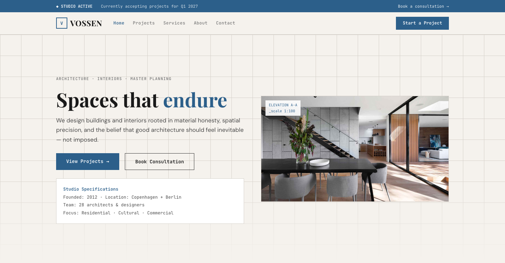

# COCO — Creative Studio Website

A modern, responsive website concept for COCO, a creative studio focused on visual identity, spatial design, interior concepts, and digital experiences.

The project transforms an existing architecture studio template into a new creative studio identity, with a custom visual direction, updated content, and a warm, minimal color palette.

## Preview



## Pages

- **Home** — Studio introduction, featured concepts, services, and design philosophy.
- **About** — COCO's creative vision, values, and design principles.
- **Services** — Creative direction, interior design, spatial design, brand identity, digital design, and 3D visualization.
- **Projects** — A collection of four conceptual design projects.
- **Contact** — Contact form interface with client-side validation.

## Features

- Responsive multi-page layout
- Custom visual identity and color palette
- Mobile navigation menu
- Active navigation link highlighting
- Scroll reveal animations
- Animated counters
- Contact form validation
- Smooth scrolling
- Dynamic footer year
- Reduced-motion support

**Note:** The contact form is a front-end demonstration. It validates user input but does not send messages to a server or inbox.

## Built With

- HTML5
- CSS3
- JavaScript (Vanilla JS)
- Google Fonts

## Design Direction

The visual identity uses a warm, minimal palette:

- Espresso
- Mocha
- Cappuccino
- Cream
- Ivory

Typography combines Cormorant Garamond for headings and DM Sans for body text.

## Project Structure

```text
coco-creative-studio/
├── index.html
├── about.html
├── service.html
├── project.html
├── contact.html
├── assets/
│   ├── css/
│   │   └── base.css
│   ├── js/
│   │   └── main.js
│   └── img/
├── .github/
│   └── workflows/
├── .gitignore
└── README.md
```

## Getting Started

No installation or build process is required.

1. Clone the repository.
2. Open the project folder in your code editor.
3. Open `index.html` in your browser, or use the VS Code Live Server extension.

## Project Background & Credits

COCO is a self-initiated website concept developed by customizing and adapting an existing VOSSEN architecture studio HTML template.

The original template structure and source assets have been adapted for this project. Original image credits are attributed in the source template to Arkitektur.

This project is a design and front-end development exercise. The featured projects are conceptual and do not represent commissioned client work.

---

**COCO — Creative Spaces. Bold Ideas.**